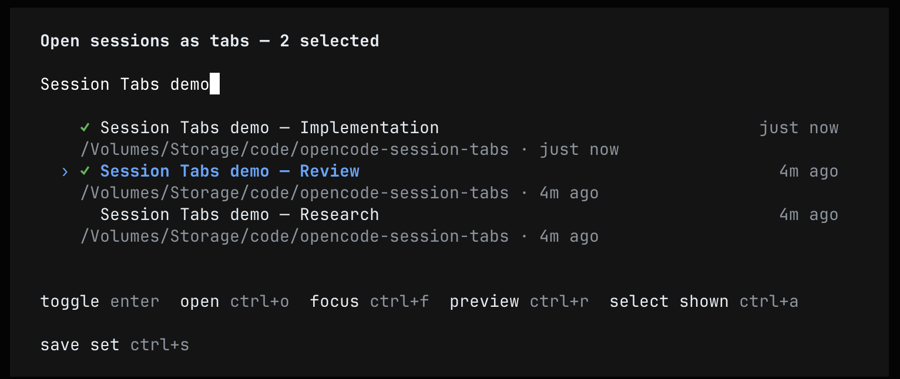
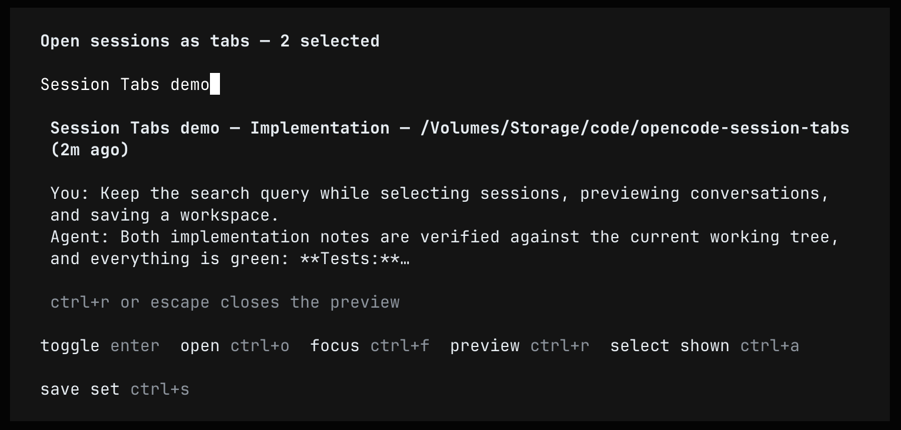
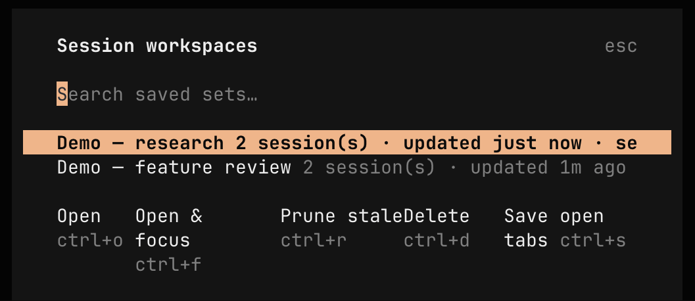

# OpenCode Session Tabs

**Bring your other OpenCode sessions back into view—without restarting their work.**

Three ways to open existing sessions as TUI tabs:

- an agent tool, `open_session_tabs`, for prompts like "open my three review sessions";
- an interactive **session picker**: search, preview, and batch-open sessions (default `<leader>p` or `/tabs`);
  it lists every top-level session on the connected server — across all projects and directories — not just the
  current one (child/subagent sessions are excluded; they appear inside their parent's tab);
- **saved session sets** ("workspaces"): named, durable groups you can reopen, prune, and save from your open tabs (default `<leader>k` or `/workspaces`).

Uses only documented OpenCode **2.0** plugin APIs: `Plugin.define`, tool transforms, typed plugin
RPC/events, plugin storage, TUI keymap commands (including modal-scoped dialog layers), the
promise-based TUI dialogs, and the custom-JSX `ui.dialog.show` surface for the picker. No V1
hooks, legacy SDK, filesystem IPC, or extra credentials. The JSX picker uses OpenCode's
host-provided OpenTUI/Solid peers. Tested with OpenCode **2.0.30**.
Opening a tab never sends a prompt or resumes an agent.

## Screenshots

Captured in Ghostty with OpenCode 2.0.30, using disposable demo sessions.

**Batch selection with persistent search.** Toggle sessions without losing your query or place in the list.



**Inline session preview.** Read the recent exchange; Escape returns to the same filtered list and selection.



**Saved workspaces.** Reopen named session sets, save open tabs, or prune missing sessions with confirmation.



## Quick start

### 1. Install

Run these in your shell:

```sh
opencode plugin add github:briansunter/opencode-session-tabs
opencode reload
```

Requires **OpenCode 2.0**, not V1. Check with `opencode --version`.
The package includes both server and TUI entrypoints; there is no need to add it
separately to `cli.json`, install dependencies, or create an API key.
It is published on GitHub, not the npm registry.

### 2. Pick sessions interactively

In an OpenCode TUI, press **`<leader>p`** (the default leader is `ctrl+x`, so `ctrl+x p`), run
**Open sessions as tabs** from the command palette (`ctrl+p`), or type `/tabs`.

- **Search** by title, directory, session ID, or previewed text.
- The list is **global**: sessions from every directory and project the server manages, newest
  first, discovered live from the server when the command starts (cursor-paginated, capped at the
  1000 most recent). Run `/tabs` again to refresh it.
- The list is **top-level conversations only**. Child/subagent sessions never appear: they are not
  tabs of their own — they live inside their parent session's tab, so you open the parent instead.
- **Enter** or **`ctrl+t`** toggles the highlighted session into your selection (`✓`).
- **`ctrl+a`** selects/clears everything matching the current search.
- **`ctrl+r`** toggles an inline preview of the highlighted session under the search field:
  title, directory, recency, and the last user prompt and assistant reply. The search box,
  query, selection, and highlight all stay in place while the preview is open; **Escape** closes
  the preview first, and a second Escape closes the picker.
- **`ctrl+o`** opens the selection as **background tabs**; focus stays where it is.
  With nothing selected, it opens just the highlighted session.
- **`ctrl+f`** opens the selection **and focuses the last tab** — focusing is always explicit.
- **`ctrl+s`** saves the selection as a named set. When the save dialogs close, the picker
  reappears exactly as you left it: same query, same highlight, same selection.
- **Escape** closes the preview (if open), then the picker; nothing is opened.

The picker keeps its own state, so **the search input never resets**: filtering, toggling,
selecting, previewing, and saving all preserve the exact query, the highlighted row, and the
selection. Arrow keys (plus `pageup`/`pagedown`, `home`, `end`) move the highlight; typed text
filters title, directory, session ID, and any preview text already loaded.

### 3. Work with saved sets

Press **`<leader>k`** (or `/workspaces`) for the **Session workspaces** dialog:

- **Enter** / **`ctrl+o`** opens the highlighted set as background tabs; **`ctrl+f`** focuses the last.
- **`ctrl+r`** prunes sessions that no longer exist from the set (asks first).
- **`ctrl+d`** deletes a set (asks first; sessions and tabs are untouched).
- **`ctrl+s`** saves your currently open tabs as a new set, in tab order.

Sets are stored in OpenCode plugin storage on the server and validated on every read: corrupt
entries are skipped, names are trimmed and bounded, and saving refuses IDs that no longer exist.
Opening a set with missing sessions asks before skipping them. The agent tool can open them too:

> Use open_session_tabs with workspace "review" to open my saved review set.

### 4. Or just ask OpenCode

In an open session, paste:

> Use open_session_tabs to open this current session as a tab. Keep focus here
> and don't send any messages to other sessions.

This is a safe first check: the tool should confirm the current session is
already open, or add its tab if needed.

**The plugin opens tabs; it does not decide which sessions matter.** Use the picker, the session
API, or `opencode session list --format json` for discovery.

### 5. Check the result

The selected sessions appear in the tab strip. Your current tab stays selected
unless you explicitly asked to switch. Opening a tab does not send a prompt or
restart an interrupted agent.

If you cannot see tabs, press **Ctrl+P → Open settings** and enable session tabs.
See [Troubleshooting](#troubleshooting) below.

## Everyday examples

| What you want | What to do |
| --- | --- |
| Open known sessions | “Use open_session_tabs for these session IDs: …” |
| Browse and batch-open | `<leader>p`, search, Enter to select several, `ctrl+o` |
| Switch after opening | Select several, then `ctrl+f` (or ask for `focus: true`) |
| Remember a working set | In the picker: select sessions, `ctrl+s`, name it |
| Snapshot today's tabs | `<leader>k`, then `ctrl+s` "Save open tabs" |
| Reopen yesterday's set | `<leader>k`, Enter |
| Clean up a stale set | `<leader>k`, highlight it, `ctrl+r` |
| Review unfinished work | “Find recent sessions with pending work, show me the list, then open the ones I choose.” |

To find IDs yourself, run this in your shell:

```sh
opencode session list --max-count 20 --format json
```

## Commands and keyboard integration

The TUI plugin registers two named commands in a global keymap layer:

| Command ID | Default | Also reachable as |
| --- | --- | --- |
| `local.session-tabs.picker` | `<leader>p` | Command palette, `/tabs` |
| `local.session-tabs.workspaces` | `<leader>k` | Command palette, `/workspaces` |

Bindings are configurable in two ways:

1. **Rebind or disable by command ID** in `~/.config/opencode/cli.json` (or
   `$XDG_CONFIG_HOME/opencode/cli.json`). Merge; don't replace existing settings:

   ```json
   {
     "keybinds": {
       "local.session-tabs.picker": "ctrl+alt+p",
       "local.session-tabs.workspaces": "none"
     }
   }
   ```

2. **Set default bindings via plugin options** where the plugin is configured:

   ```jsonc
   {
     "plugins": [
       {
         "package": "github:briansunter/opencode-session-tabs",
         "options": { "pickerBind": "<leader>o", "workspacesBind": false }
       }
     ]
   }
   ```

   `false` disables the automatic binding; the command stays in the palette and slash completion.

Inside the picker, the action keys (`enter`, `ctrl+t`, `ctrl+o`, `ctrl+f`, `ctrl+r`,
`ctrl+a`, `ctrl+s`) and navigation (`up`/`down`, `pageup`/`pagedown`, `home`, `end`,
`escape`) are registered by the plugin in the host's modal keymap mode, so they apply only
while the picker is open and never leak to the background or to other dialogs. Each binding
is a named command (`local.session-tabs.picker.*`) you can rebind by ID in the same
`keybinds` map. The saved-set dialogs (`<leader>k`) use `ctrl+o`, `ctrl+f`, `ctrl+r`,
`ctrl+d`, and `ctrl+s` while they are open.

## Tool reference

This is an **agent tool call**, not a shell command or slash command:

```js
open_session_tabs({
  sessionIDs: ["ses_example_one", "ses_example_two"],
  focus: false,
})
// or, by saved set:
open_session_tabs({ workspace: "review" })
```

Pass exactly one of `sessionIDs` or `workspace`.

| Argument | Required | Meaning |
| --- | --- | --- |
| `sessionIDs` | One of the two | 1–20 existing top-level session IDs, including sessions from different projects. Child (subagent) sessions are rejected — open their parent instead. |
| `workspace` | One of the two | Name of a saved set created from the TUI picker or workspaces dialog. |
| `focus` | No | Defaults to `false`. Set `true` to focus the last requested session. |

Example successful result:

```json
{
  "opened": ["ses_example_two"],
  "alreadyOpen": ["ses_example_one"],
  "focused": false
}
```

`opened` lists newly added tabs; `alreadyOpen` lists tabs that were already there.
Repeated calls do not create duplicate tabs.

### Safety and limits

- Opens existing sessions only, up to 20 IDs per call or per saved set; duplicates are ignored.
- Only top-level sessions can be tabs. A child/subagent session ID is rejected **before any tab is
  opened** with `"<child> is a child session. Open parent <parent> instead; child sessions appear
  inside parent."` — including when it comes from a saved set, which is left unmodified. IDs are
  never silently rewritten to their parent: the reported result always matches the requested IDs.
- Never sends messages, starts execution, creates or deletes sessions, or closes tabs.
- Checks that every requested session exists before requesting any tabs — including every session
  in a saved set.
- Waits for the TUI to confirm the requested tabs instead of assuming success.
- Saved sets are validated when written (names trimmed, 1–64 characters, no control characters;
  IDs deduplicated and existence-checked) and when read (corrupt entries are skipped, not fatal).
- Opening a set with stale sessions asks before skipping them; pruning rewrites the set only after
  confirmation; deleting a set never touches sessions or tabs.
- The calling session must be open in a connected TUI with this plugin loaded.
  Headless `opencode run`, Mini, web, and desktop-only sessions cannot supply
  the required full-screen TUI tab interface on their own.
- If the calling session is open in multiple TUIs, the first one to claim the
  request handles it; the others leave their tabs unchanged.
- Confirmation times out after 10 seconds. A timeout or cancellation can leave
  tabs already opened intact; retrying the same IDs is safe.
- Tab preferences, session contents, and model settings are not changed.

## Troubleshooting

| Symptom | What to do |
| --- | --- |
| Agent cannot find `open_session_tabs` | Run `opencode plugin list` to check installation, then `opencode reload`. If needed, reopen the TUI with the same session. |
| “Session tabs are disabled” | Enable tabs through **Ctrl+P → Open settings**, or merge the setting below into your CLI config. |
| Picker/workspaces commands are missing | Same as above: check `opencode plugin list`, then `opencode reload`; reopen the TUI so the `./tui` entrypoint loads. |
| “No TUI confirmation received” | Keep the calling session open in a full-screen TUI connected to the same server. Reload the plugin or reopen the TUI, then retry. |
| “No sessions were found on the connected server” | The picker queries the server globally, so this means the server really has no sessions. Check that the TUI is connected to the server you expect, then run `/tabs` again. |
| “Could not load sessions from the server: …” | The discovery request failed (or timed out after 15s). The message is the server's error; check the connection and run `/tabs` again. |
| Session ID is invalid or not found | Copy the full ID from `opencode session list --max-count 20 --format json`. The session must exist on the connected server. |
| “… is a child session. Open parent … instead” | You asked for a child/subagent session. Child sessions appear inside their parent's tab, so open the parent ID named in the message instead. Nothing was opened; saved sets are never rewritten automatically. |
| “OpenCode did not retain tab …” | Some tabs may have opened. Let the TUI finish loading, then retry the same IDs; existing tabs are skipped. |
| A saved set contains missing sessions | Open it and answer the prompt to skip them, or press `ctrl+r` in the workspaces dialog to prune the set. |
| Plugin was unloaded during a call | A reload interrupted the request. Wait for reload to finish, then retry. |

If enabling tabs manually, **merge** this into `~/.config/opencode/cli.json`;
do not replace your other settings. If `XDG_CONFIG_HOME` is set, use
`$XDG_CONFIG_HOME/opencode/cli.json` instead.

```json
{
  "tabs": {
    "mode": "on"
  }
}
```

See OpenCode's [tab settings](https://opencode.ai/v2/docs/cli/config#tabs) and
[keybind reference](https://opencode.ai/v2/docs/cli/keybinds).
Do not install both a local checkout and the GitHub package at the same time.

## Local development

```sh
git clone https://github.com/briansunter/opencode-session-tabs.git
cd opencode-session-tabs
bun install        # dev-only dependencies (plugin types, OpenTUI peers for module-graph checks)
bun test           # unit tests + real-UI dialog tests (bunfig.toml preloads the Solid JSX transform)
bun run typecheck  # tsc --noEmit against @opencode/plugin 2.0.30 types
```

`bunfig.toml` preloads `@opentui/solid/preload` so `bun test` compiles the plugin's `.tsx`
with the same `babel-preset-solid` transform the OpenCode TUI host installs for plugin
sources; the file is inert everywhere else.

To load the checkout, symlink it into OpenCode's plugin directory and reload:

```sh
mkdir -p ~/.config/opencode/plugins
ln -s "$(pwd)" ~/.config/opencode/plugins/session-tabs
opencode reload
```

Use either the GitHub installation or the local symlink, not both. If the local
plugin path already exists, preserve it rather than overwriting it.

Tests cover validation, duplicate handling, background/focused tabs, delayed TUI
updates, routing, acknowledgements, timeouts, cancellation, partial failures,
child/subagent session exclusion (discovery filtering and the pre-open
rejection, including mixed root/child batches and saved sets), workspace
save/list/remove/prune with corrupt data, stale-session partitioning,
relative-time and preview-text formatting, search filtering, race-safe preview
loading with cross-location fallbacks, global paginated session discovery
(cursor chaining, caps, dedupe, truncation, roots-only filtering), and every
picker/workspace dialog flow against a scripted fake dialog. The picker
additionally has real-UI tests (`picker-ui.test.tsx`) that mount the actual
dialog through OpenTUI's test renderer and type into the real search input:
they pin the exact query, highlight, and selection across toggles, inline
previews, Escape handling, and full save-set round-trips, plus the modal
keymap scope the bindings live in.

### How it works

1. `index.ts` registers the tool and workspace RPC with OpenCode's V2 server plugin API, storing
   saved sets in plugin storage (`ctx.storage`).
2. The tool validates the sessions (or resolves a saved set, then validates) and emits an RPC
   request defined in `rpc.ts`.
3. `tui.ts` listens for requests from sessions open in that TUI, and registers the picker and
   workspaces commands in a keymap layer.
4. One TUI claims the request, preloads the sessions, and opens their tabs; the TUI acknowledges
   the result, which the tool returns to the agent.
5. The picker renders a custom dialog through the documented `ui.dialog.show` JSX API with
   its own Solid state held outside the dialog component — that is why the search input,
   query, highlight, selection, and inline preview survive every interaction. Its key
   bindings are registered in the host's modal keymap mode for the dialog's lifetime. The
   picker discovers sessions once per invocation through `client.session.list` with cursor
   pagination (global scope: no directory/project filter), so it works from any directory. Child
   and subagent sessions (a truthy string `parentID` in `SessionInfo`) are filtered out because
   they render inside their parent's tab, not as tabs of their own; before any tab is opened, the
   TUI also preflights each requested ID against the session cache and rejects child IDs with the
   parent to open instead. Previews read the sessionID-keyed data cache and fall back to a direct
   client message fetch for sessions the TUI never loaded, with a newest-wins guard against
   async races; loaded preview text also joins the search haystack. The workspaces dialog is
   built from the promise-based `ui.dialog.select` API.

`core.js` contains the bridge, tab, workspace, and preview logic; `picker.tsx` holds the
reactive picker controller, its Solid dialog view, and the picker flow. The `*.test.js` files
test the logic against mocked host APIs, and `picker-ui.test.tsx` exercises the rendered
dialog itself through OpenTUI's test renderer. The plugin uses OpenCode's existing authenticated
connection—no extra service, database, or credential store.

## Advanced: HTTP API

The same bridge is accessible with `opencode api` (use the caller session's
directory so the correct location-scoped plugin handles the request):

```sh
opencode api post /api/rpc/session-tabs/open --data \
  '{"input":{"originSessionID":"ses_...","sessionIDs":["ses_..."],"focus":false}}'
opencode api post /api/rpc/session-tabs/workspaceList --data '{"input":{}}'
opencode api post /api/rpc/session-tabs/workspaceSave --data \
  '{"input":{"name":"review","sessionIDs":["ses_..."]}}'
```

`originSessionID` selects the TUI; the tool derives it from its execution context.
The RPC uses the existing authenticated OpenCode connection.

## Reloading and uninstalling

Run `opencode reload` after installation. Local plugins are auto-discovered, so
the symlink installation needs no `opencode.json` or `cli.json` changes. If an
existing terminal does not load the TUI entrypoint dynamically, reopen that
OpenCode TUI (no server restart or session deletion needed).

For the local installation, remove only the `session-tabs` symlink and reload
OpenCode; keep your checkout. For a GitHub installation, remove its entry from
the global `plugins` configuration and reload. Existing tabs, sessions, and
saved sets remain intact (sets can be removed from the workspaces dialog).

## License

[MIT](LICENSE) © 2026 Brian Sunter. Free to use, modify, and redistribute,
including commercially, with the license notice retained.
